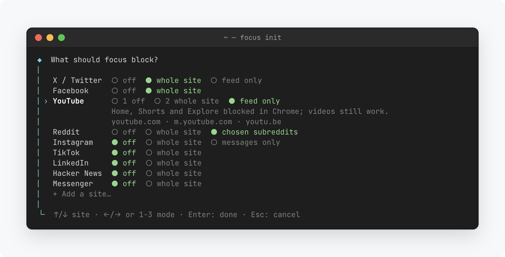
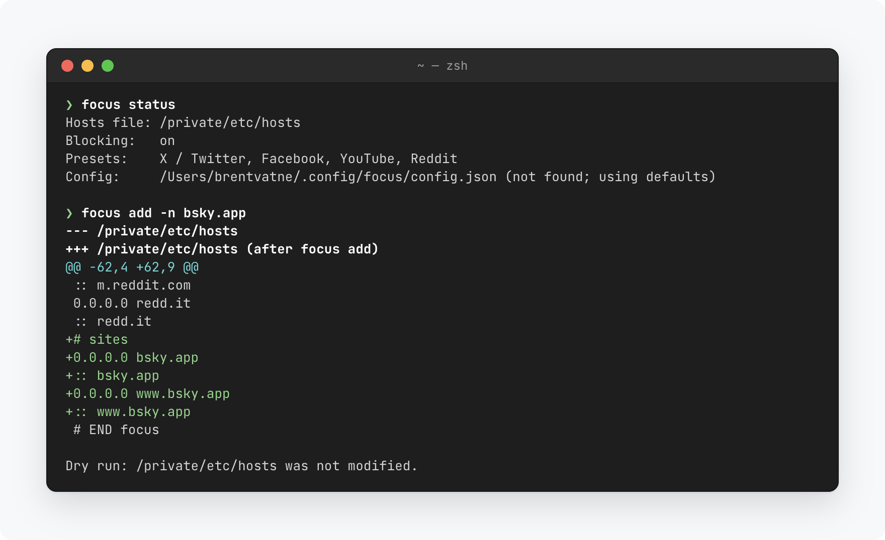

# focus

Block distracting websites on macOS. focus manages one marked section of `/etc/hosts`, leaves the rest of the file alone, and every change can be undone.

<picture>
  <source media="(prefers-color-scheme: dark)" srcset="docs/images/init-dark.png">
  
</picture>

## Install

```bash
curl -fsSL https://raw.githubusercontent.com/brentvatne/focus/main/install.sh | sh
focus init
```

Apple silicon only. Run `focus setup-sudo` once if you don't want to type your password each time focus changes `/etc/hosts`.

## Use

```bash
focus init               # choose presets: X, Facebook, YouTube, Reddit, …
focus add example.com    # block anything else
focus                    # toggle blocking on or off
focus off                # take a break; `focus on` to resume
focus reddit allow rust  # keep chosen subreddits in Chrome (setup in the guide)
focus status
focus upgrade
```

Add `-n` to any command to preview the change as a diff.

<picture>
  <source media="(prefers-color-scheme: dark)" srcset="docs/images/session-dark.png">
  
</picture>

## Manual recovery

Delete everything between `# BEGIN focus` and `# END focus`:

```bash
sudo sed -i '' '/^# BEGIN focus$/,/^# END focus$/d' /etc/hosts
```

The previous version of the file is always at `/etc/hosts.focus-backup`.

See the [guide](docs/guide.md) for presets, configuration, how it works and more recovery options.
