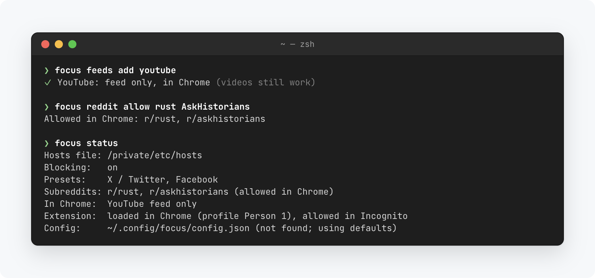
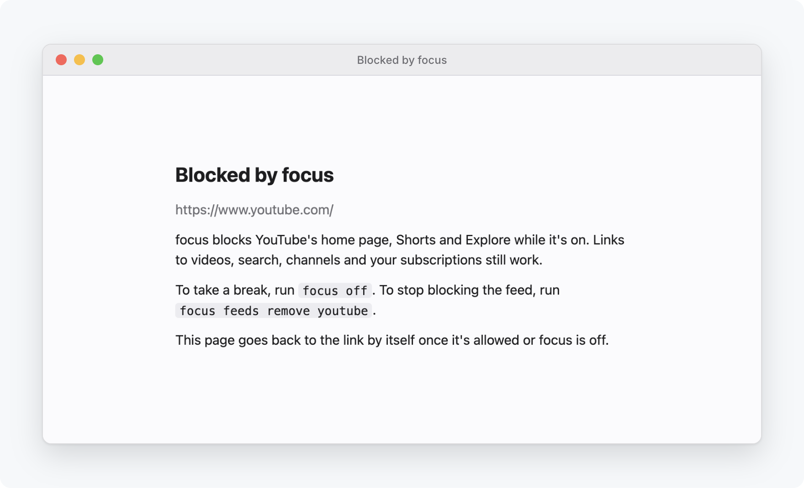

# focus

Block distracting websites on macOS. focus manages one marked section of `/etc/hosts`, leaves the rest of the file alone, and every change can be undone. In Chrome, it can also block just part of a site: YouTube's feed but not its videos, every subreddit but the ones you choose.

<picture>
  <source media="(prefers-color-scheme: dark)" srcset="docs/images/init-dark.png">
  
</picture>

## Install

```bash
curl -fsSL https://raw.githubusercontent.com/brentvatne/focus/main/install.sh | sh
focus init
```

Apple silicon only. Run `focus setup-sudo` once if you don't want to type your password each time focus changes `/etc/hosts`.

## Use

```bash
focus                    # toggle blocking on or off
focus off                # take a break; `focus on` to resume
focus config             # change what's blocked: the same list as init
focus add example.com    # block anything else (`focus remove` unblocks it)
focus status
focus upgrade
```

Add `-n` to any command to preview the change as a diff.

<picture>
  <source media="(prefers-color-scheme: dark)" srcset="docs/images/session-dark.png">
  
</picture>

## Just part of a site, in Chrome

```bash
focus feeds add youtube x instagram   # their feeds go; videos, posts and messages stay
focus reddit allow rust               # every subreddit but these goes
focus chrome install                  # once: sets up the Chrome extension step by step
```

`focus config` has the same options, one row per site.

<picture>
  <source media="(prefers-color-scheme: dark)" srcset="docs/images/chrome-dark.png">
  
</picture>

A blocked page says why, and goes back to the link by itself once it's allowed or focus is off:

<picture>
  <source media="(prefers-color-scheme: dark)" srcset="docs/images/blocked-dark.png">
  
</picture>

## Manual recovery

Delete everything between `# BEGIN focus` and `# END focus`:

```bash
sudo sed -i '' '/^# BEGIN focus$/,/^# END focus$/d' /etc/hosts
```

The previous version of the file is always at `/etc/hosts.focus-backup`. If you use the Chrome extension, remove "focus" at `chrome://extensions` too.

See the [guide](docs/guide.md) for presets, the Chrome options, configuration, how it works and more recovery options.
